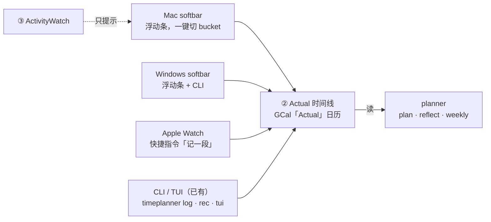

# TimePlanner：休息与恢复 + 多端 softbar 提案

2026-11-04 · 分支 `feat/rest-recovery`（尚未合进 main，PR #1 已关闭）

## 背景与目标

目标：让 planner 主动排休息和恢复，而不是只排工作块；再加一个随手就能记时间的入口。
原来的 `principles.md` 只管「每块到点硬停」，没有回答「什么时候该整块休」「面完怎么回来」。

要解决的实际问题：

- 每周没有一天真正 off，周末是「半办公」，休不够，工作日就靠颓废补。
- 大面试或 deadline 之后没有计划的恢复期，结果失控地玩一两天，回来也难。
- 从工作直接滑进游戏，没有切换动作，玩的时候心里还挂着活。
- 对休息有负罪感，倾向把休息日往小了砍。
- 记时间要打开终端敲命令，成本高，记不下来。

设计原则：休息是**提前排好的**，有终点；planner 只给软提醒，不拦截任何写入（和现有的辅助式闸门一致）。

## 一、休息与恢复

### 行为设计

每天先判断是哪种日子，再按对应规则排；按下面的优先级，命中第一条就停。

| 优先级 | 日子 | 怎么判断 | 怎么排 |
| --- | --- | --- | --- |
| 1 | 大事件当天 | 当天事件或 📅 deadline 命中大事件关键词（终面、onsite、deadline、投稿） | 事件结束后全 off；收工前写下回来后的第一件事 |
| 2 | 休息日 | 星期几等于 `TIMEPLANNER_REST_WEEKDAY`（默认周六） | 全天不排 main/side，也不排「半办公」 |
| 3 | 回来日 | 昨天有大事件 | 上午 off，下午回主场；底线是一件 5 分钟能开始的小事，不补进度 |
| 4 | 小事件当天 | 命中小事件关键词（面试、phone screen、OA） | 面完那个晚上（18:00 起）off，第二天照常 |
| 5 | 普通日 | 以上都不是 | 正常排 |

两条合并规则，避免一周 off 两天：

- 大事件在休息日前一天（比如周五 deadline），第二天直接是休息日，不再算回来日。
- 大事件落在休息日当天，按大事件当天处理，事件之外仍不排工作。

**每天都适用的收尾仪式**：fun 块在 main/side 结束后 30 分钟内开始，就提醒中间加 10–15 分钟 life 收尾——
写 next action → 收拾房间（只收桌面和地上）→ 再玩。

**哪些不算事件**：planner 自己排的块，以及标题含「准备 / prep / mock / 模拟 / 复盘 / review」的块。
比如「TikTok 面试准备」不会让当天变成面试日。

事件来源：订阅日历、Plan 里手建的外部事件、Actual 记录、项目笔记里当天的 📅 deadline
（deadline 也要命中关键词才算，一般的作业 ddl 不会触发）。

### 配置项

关键词逗号分隔、不区分大小写；英文词按整词匹配（`oa` 不会匹配到 `load`），中文按子串匹配。

| 变量 | 默认值 | 作用 |
| --- | --- | --- |
| `TIMEPLANNER_REST_WEEKDAY` | `sat` | 每周休息日；接受 mon..sun、周一..周日、0..6；留空关闭 |
| `TIMEPLANNER_BIG_EVENT_KEYWORDS` | onsite, 终面, final round, deadline, ddl, 投稿, submission, 答辩, defense, 大面 | 大事件：当天事件后 off + 第二天上午 off |
| `TIMEPLANNER_MINOR_EVENT_KEYWORDS` | 面试, interview, phone screen, oa, coding test | 小事件：面完那个晚上 off |

## 二、多端与 softbar

结论：softbar、PC 端、手表端都只写同一条 ②Actual 时间线，共享层用 GCal 后端（`TIMEPLANNER_BACKEND=gcal`）。



所有端只写 ②Actual；ActivityWatch 只给 softbar 提建议，不直接写。

### 浮动条 softbar（`timeplanner softbar`）

屏幕顶部一条细长、始终置顶的条，一眼看到：今天是哪种日子、当前计划块和剩余时间、正在记录的活动和已过时长。

「软记录」= 一键切换，不填表：

- 点一个 bucket（main / side / 生活 / 健康 / 玩），就结束上一段、写进 Actual、开始新一段。
  和 TUI 录制器、`timeplanner log` 走同一条 `backend.log_actual`，local 和 gcal 后端都行。
- 描述可选：输入框里打字回车，按关键词猜 bucket。
- 从工作直接切到「玩」时问「先收尾 12 分钟？」：点好就先记一段 life 收尾，12 分钟后提醒点「玩」。
- 休息日、回来日上午、事件结束后点 main/side，提示一次，再点一次照样开始。
- 关掉浮动条不停止记录：进行中那段存在 `data/running.json`，重新打开接着记。跨午夜的一段自动拆成两天。
- 拖动可移位置（会记住）；右键菜单可刷新、回到屏幕顶部、退出。

实现：PySide6，Mac 和 Windows 共用一套代码，`pip install -e '.[softbar]'`。
命令行版：`timeplanner rec <bucket> [描述]` 开始/切换，`rec stop` 停止，`rec status` 看状态。

### PC 端（Windows）

Windows 已经是 AW 汇集端。PC 端 = 同一个浮动条 + `timeplanner` CLI，后端设成 gcal，和 Mac 共享 Actual。

### 手表端（Apple Watch）

不写原生 app：一个快捷指令「记一段」往 GCal「Actual」日历写事件，表盘复杂功能一键调出，
主要管离开电脑的时段（健身、出门、吃饭）。步骤见 [apple-watch-shortcuts.md](apple-watch-shortcuts.md)。
快捷指令建的事件没有 timeplanner 标记，bucket 从标题开头读（`[fun] 打塔`、`health：健身`），周报按它算小时数。

## 代码改动

| 文件 | 改动 |
| --- | --- |
| `timeplanner/core/recovery.py`（新增） | 识别大/小事件、判断日子类型、对草案出软提醒、出文本块 |
| `timeplanner/core/running.py`（新增） | 进行中的活动：开始/切换/停止，写进 Actual，跨午夜拆分；收尾和休息日提示 |
| `timeplanner/softbar.py`（新增） | PySide6 浮动条 |
| `timeplanner/agent.py` | context 加休息与恢复块；新工具 `recovery_status`；`stage_plan` 附提醒；prompt 加第 6 条规则 |
| `timeplanner/core/backend.py` | `confirm` 的 dry-run 下面列出提醒，不拦截 |
| `timeplanner/cli.py` | `summary` 打印休息与恢复块；新命令 `softbar`、`rec` |
| `timeplanner/render.py` | rich 版 `summary` 在天气下面显示同一块 |
| `timeplanner/core/classify.py`、`core/weekly.py` | 读标题开头的 bucket（手表事件），周报按它归类 |
| `timeplanner/config.py`、`pyproject.toml` | 休息日和两档关键词三个配置；`softbar` extra |
| `principles.md` | 新增「休息与恢复」一节，7 条原则 |
| `README.md`、`.env.example`、`docs/apple-watch-shortcuts.md` | 说明、配置样例、手表指南 |
| `scripts/demo_recovery.py`（新增） | 用假数据跑一周的 demo |

## demo 与验证

```bash
git fetch origin feat/rest-recovery
git worktree add ../timeplanner-demo feat/rest-recovery
cd ../timeplanner-demo
python3 scripts/demo_recovery.py      # 假数据走一周，不读写 data/、日历、笔记
pip install -e '.[softbar]' && timeplanner softbar
```

已验证（临时测试脚本，未提交，仓库目前没有测试框架）：关键词分档、准备块排除、英文整词匹配、五种日子和两条合并规则、
四类提醒、「Actual 里记了终面 → 第二天 confirm 出回来日提醒」的端到端路径；录制开始/切换/停止、跨午夜拆分、
1 分钟下限、未知 bucket 报错、标题 bucket 解析；浮动条在无界面环境下跑通 main → 收尾 → 玩 → 停止，Actual 记下三段。

## 已决定

- 手表：Apple Watch。
- softbar：直接做浮动条。
- 多端：后端切到 GCal。

## 已知局限

- 大小事件全靠标题关键词判断，会误判；标题里写「终面 / 大面」，或者调关键词。
- 📅 deadline 文本里恰好写了 deadline / ddl，作业也会被当成大事件。
- 小事件的 off 起点固定为当天 18:00（或事件结束时间，取较晚者）。
- 回来日只看前一天。
- 提醒只是文字，agent 可能不改；reflect 里还没统计「休息日有没有真休」。
- 浮动条的进行中状态是每台机器各自的；Mac 上开着一段、换到 Windows，那边看不到。
- 还没做：空闲补记、AW 猜测提示、原生手表复杂功能、健康数据。

## 待决

- [ ] 休息日默认周六，要不要改？
- [ ] 小事件的 off 起点 18:00 合不合适？
- [ ] 要不要把临时测试整理成 `tests/`，顺便加 pytest？
- [ ] reflect 的收工 4 问要不要加第 5 问「今天的休息按计划了吗」？
- [ ] 看完 demo 后：合进 main，还是改完再开 PR？
